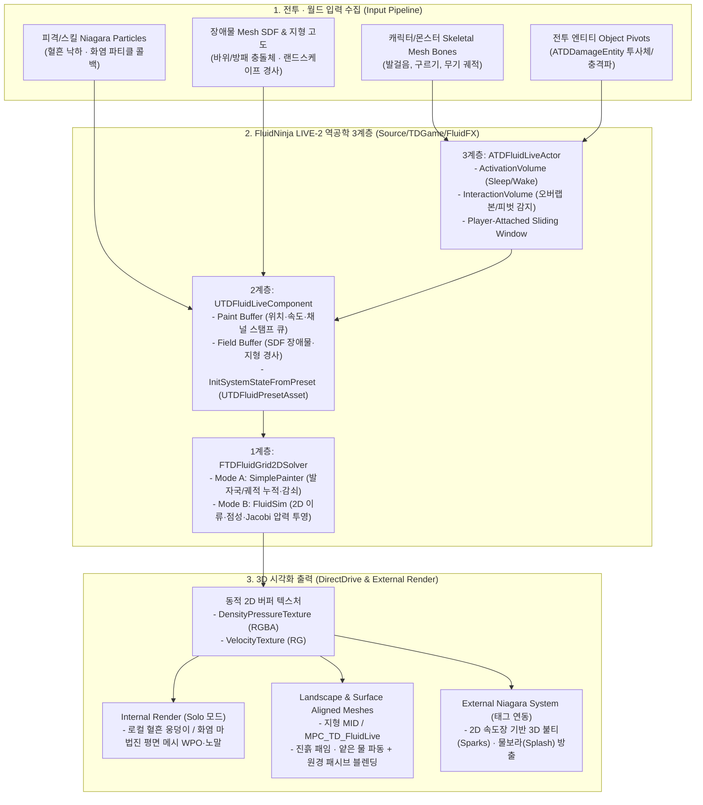

[← 인덱스로](AgentCollaboration_Plan.md)

# TD 실시간 2D-to-3D 유체 상호작용 시스템 설계 및 구현 계획서 (FluidNinja LIVE-2 역공학)

종류: 설계 · 작성: 2026-10-17 antigravity · 갱신: 2026-10-18 claude(7절 구현 현황)  
기반 자료: `오픈월드 게임에서 FluidNinja LIVE-2 활용 기술 분석` 및 FluidNinja LIVE-2 공식 매뉴얼(Rev 2.06)

---

## 1. 목표와 범위

상용 플러그인 **FluidNinja LIVE-2**의 핵심 기술인 **"2D 오일러 격자 시뮬레이션으로 3D 지형·볼륨·파티클 시각화를 구동하는 파이프라인(2D Sim to 3D Visualization)"**과 **3계층 모듈형 아키텍처(`Core` – `Component` – `Actor`)**를 역공학하여 `TDGame`의 C++ 규칙에 맞게 자체 구현한다.

- **핵심 달성 목표:**
  1. **오픈월드 환경 FX:** 플레이어 폰을 따라 이동하는 로컬 시뮬레이션 컨테이너(**슬라이딩 윈도우**)로 근경(얕은 물, 진흙, 바닥 안개, 눈/모래 발자국) 실시간 상호작용을 처리하고, 영역 밖 원경은 패시브 패턴과 경계선 없이 블렌딩한다.
  2. **전투 상호작용 FX:** 캐릭터·몬스터의 스켈레탈 본(`foot_l`, `foot_r`, 무기 소켓), 전투 투사체(`ATDDamageEntity`) 피벗, 피격 나이아가라 파티클 낙하 지점을 `Paint Buffer`에 수집하고, 바위·방패 등 장애물 거리장(SDF)을 `Field Buffer`에 수집하여 **진흙 패임(Mud), 피격 혈흔 흐름(Blood), 화염 장판 소용돌이(Fire)**를 구동한다.
  3. **TDGame 아키텍처 준수:**
     - 모든 시뮬레이션·수집·풀링·전달 로직은 **100% C++**로 구현한다(`AGENTS.md` 7절).
     - 모든 에셋 참조(머티리얼, 나이아가라 시스템)는 `TSoftObjectPtr`와 `FStreamableManager` 비동기 프리로드를 사용한다(`OP-33`, 런타임 동기 로드 0건).
     - 멀티플레이어 복제(Replication) 및 물리적 부력(Buoyancy) 판정은 원본 LIVE-2의 설계 한계와 동일하게 범위에서 제외하고 **클라이언트 시각 연출(Visual FX)** 전용으로 분리한다.

---

## 2. 원본 FluidNinja LIVE-2 역공학 매핑 및 책임 분리

원본 에셋의 블루프린트·나이아가라 래퍼 구조를 `Source/TDGame/FluidFX/` 하위의 C++ 클래스 6종으로 1:1 대응 및 통합한다.

| 원본 FluidNinja LIVE-2 요소 | TDGame 역공학 C++ 구성 | 핵심 책임 |
| --- | --- | --- |
| `Preset` (Data Asset, 323개 파라미터) | `UTDFluidPresetAsset` (`UDataAsset`) | 유체 모드(`SimplePainter` / `FluidSim`), 해상도, 영역 크기, 점성(`Viscosity`), 감쇠(`Dissipation`), 와류(`Vorticity`), 중력 경사 반응도, 출력 머티리얼/나이아가라 소프트 참조 보관 |
| `Live Core Niagara System` (1계층) | `FTDFluidGrid2DSolver` (C++ 코어 솔버) | 2D 격자 버퍼(`Density`, `Velocity`, `Pressure`, `PaintBuffer`, `FieldBuffer`) 관리, Semi-Lagrangian 이류·Jacobi 압력 투영·점성 확산·지형 경사 가속·슬라이딩 윈도우 시프트 연산 수행 |
| `Live Component` (2계층 래퍼) | `UTDFluidLiveComponent` (`UActorComponent`) | 입력 브러시/SDF 큐 수집, `InitSystemStateFromPreset` 초기화, 시뮬레이션 결과를 동적 2D 텍스처(`DensityPressureMap`, `VelocityMap`)로 패킹, 내·외부 MID 및 나이아가라로 DirectDrive 출력 |
| `Live Actor` (3계층 액터) | `ATDFluidLiveActor` (`AActor`) | `ActivationVolume`(플레이어 근접 Sleep/Wake), `InteractionVolume`(오버랩 스켈레탈 본·액터 피벗 자동 추적), 플레이어 추적형 슬라이딩 윈도우 이동 제어, Solo 모드 내부 평면 메시 보유 |
| `Ninja Spawner` + `Landscape Utility` | `UTDFluidLiveSubsystem` (`UTickableWorldSubsystem`) | 전투 이벤트용 `ATDFluidLiveActor` 오브젝트 풀링 스폰, 태그 기반 외부 시스템(`DriveNiagaraComponentInTaggedActors`) 및 지형 MID/`MPC` 바인딩, 프레임당 최대 포인트 입력 예산(`MaxPointsPerTick`) 제어 |



---

## 3. 핵심 알고리즘 및 데이터 파이프라인 역공학 명세

### 3.1 입력 버퍼 체계 (`Paint Buffer` & `Field Buffer`)

1. **`Paint Buffer` (포인트·속도 브러시 입력):**
   - `InteractionVolume` 내부에 진입한 액터의 중심점(Pivot)과 스켈레탈 메시의 지정 본(`TrackedBoneNames`: 기본 `foot_l`, `foot_r`, `hand_r`)의 이전 프레임 월드 좌표 $\mathbf{P}_{t-1}$과 현재 좌표 $\mathbf{P}_t$로부터 속도 벡터 $\mathbf{V} = (\mathbf{P}_t - \mathbf{P}_{t-1}) / \Delta t$를 산출한다.
   - 월드 좌표 $(X, Y)$를 시뮬레이션 영역 중심 $\mathbf{C}_{\text{sim}}$과 크기 $\mathbf{E}_{\text{sim}}$ 기준 정규화 UV $(u, v) \in [0, 1]^2$로 변환한다:
     $$u = \frac{X - (C_X - E_X / 2)}{E_X}, \quad v = \frac{Y - (C_Y - E_Y / 2)}{E_Y}$$
   - **Selective Brush Density (선택적 브러시 밀도 채널, 매뉴얼 8.1절):**
     단일 `ATDFluidLiveActor` 안에서 여러 재질 상호작용을 동시에 처리할 수 있도록 브러시 입력마다 채널(`ETDFluidBrushChannel`: `ChannelR_Mud`, `ChannelG_Blood`, `ChannelB_Fire`, `ChannelA_Water`)을 지정한다.
   - **GPU/CPU 부하 방지 상한 (`MaxPointsPerTick`):**
     다수 몬스터 교전 시 프레임 드랍을 막기 위해 프레임당 처리할 포인트 스탬프 수를 기본 `64`개로 제한하며, 카메라/플레이어에 가까운 순서로 우선 처리한다.

2. **`Field Buffer` (SDF 장애물 및 지형 경사 입력):**
   - 시뮬레이션 영역 내 장애물(바위, 기둥, 보스 방패 등)의 2D 투영 부호 거리장(Signed Distance Field, $\phi(x, y)$)을 기록한다. $\phi \le 0$인 내부 셀은 고체 경계(Solid Obstacle)로 마킹하여 속도 벡터의 법선 성분을 제거($\mathbf{v} \cdot \nabla\phi = 0$)함으로써 불길이나 물줄기가 바위를 뚫지 않고 양옆으로 갈라져 흐르게 만든다.
   - 지형 고도 필드 $H(x, y)$의 기울기 $-\nabla H = (-\frac{\partial H}{\partial x}, -\frac{\partial H}{\partial y})$를 계산하여 매 스텝 속도장에 중력 경사 가속도 $\mathbf{a}_{\text{terrain}} = -g_{\text{slope}} \nabla H$를 더한다. 이를 통해 피격 혈흔이나 시냇물이 지형 경사면을 따라 자연스럽게 아래로 흘러내린다.

### 3.2 시뮬레이션 코어 (`SimplePainter` vs `FluidSim` 모드)

| 구분 | `ETDFluidSimMode::SimplePainter` | `ETDFluidSimMode::FluidSim` |
| --- | --- | --- |
| **용도** | 눈밭·모래·건조한 진흙 위의 발자국, 바퀴 자국, 무기 긁힘 궤적 | 얕은 물 파동, 점성 진흙/혈흔 흐름, 바닥 안개 갈라짐, 화염 소용돌이 |
| **연산 단계** | 브러시 스탬프 주입 $\to$ 시간 감쇠(`DensityDissipation`) | 브러시 주입 + 지형 경사 가속 $\to$ Semi-Lagrangian 속도·밀도 이류 $\to$ 와류 보강(Vorticity Confinement) $\to$ 점성 감쇠(Viscosity) $\to$ 발산 및 Jacobi 압력 투영($N$회) $\to$ 속도 보정 |
| **복잡도/비용** | $O(W \times H)$ 단순 감쇠 (초저비용) | $O(W \times H \times N_{\text{jacobi}})$ (`ParallelFor` 병렬 처리) |

- **점성 유체(Viscous Fluids, 매뉴얼 8.3절) 구현 원리:**
  - 물(`Water`): 낮은 점성(`VelocityDamping = 0.02`), 높은 압력 전파율로 잔물결이 빠르게 퍼진다.
  - 진흙·혈흔(`Mud` / `Blood`): 높은 점성(`VelocityDamping = 0.45 ~ 0.70`), 낮은 밀도 감쇠(`DensityDissipation = 0.01`)와 압력 축적을 통해 브러시가 지나간 자리의 가장자리가 뭉근하게 밀려 올라와(`Pressure` $\to$ 머티리얼 WPO/노말 범프) 오랫동안 유지된다.
  - 바닥 안개·화염(`LowFog` / `Fire`): 중간 점성(`0.15`), 높은 와류 보강(`VorticityStrength = 2.5`)으로 캐릭터 이동 시 소용돌이(Curl)가 피어오른다.

### 3.3 오픈월드 슬라이딩 윈도우 (Player-Attached Container)

- `ATDFluidLiveActor`에서 `bFollowPlayerPawn = true`로 설정되면 매 틱 플레이어 폰의 $(X, Y)$ 이동량을 추적한다.
- 미세 이동 시 서브텍셀 떨림(Jitter)을 막기 위해 **월드 그리드 스냅 단위($\Delta_{\text{cell}} = \text{SimExtentCm} / \text{GridResolution}$)** 이상 이동했을 때만 시뮬레이션 중심 좌표를 정수 텍셀 단위로 이동시키고, 내부 2D 버퍼 배열을 반대 방향 $(-\Delta i, -\Delta j)$만큼 시프트(Shift)한다.
- 새로 진입한 가장자리 행·열은 `0`으로 초기화하며, 머티리얼에는 현재 스냅된 `SimCenterWorld`와 `SimExtentsCm`, 그리고 가장자리 페이드 폭(`BorderFadeRatio = 0.1`)을 전달하여 원경 패시브 패턴과 경계선 없이 합성한다.

### 3.4 출력 텍스처 패킹 및 DirectDrive 브리지

시뮬레이션 결과는 프레임마다 2장의 동적 텍스처(`EPixelFormat::PF_B8G8R8A8` 또는 `PF_FloatRGBA`)로 패킹되어 렌더러에 전달된다:

1. **`DensityPressureTexture`:**
   - `R`: 주 밀도(Primary Density, $0 \sim 1$)
   - `G`: 정규화 압력(Normalized Pressure, $0.5$ 기준 $\pm$파고/WPO 변위용)
   - `B`: 보조 선택적 브러시 밀도(Selective Channel Density: 혈흔/화염 구분용)
   - `A`: 장애물 SDF 마스크 및 경계 알파(Edge Fade Mask)
2. **`VelocityTexture`:**
   - `R`, `G`: 정규화 2D 속도 벡터 $(V_x, V_y)$ ($0.5$가 정지 상태, Flowmap UV 왜곡 및 파티클 가속용)
   - `B`: 속도 크기($\|\mathbf{V}\|$, 거품/포말/발광 강도용)
   - `A`: 지형 고도 기울기 마스크

---

## 4. 연산 백엔드 설계 선택지 및 절충점

**결정: 방식 A**(`Docs/Tasks/decisions.md` D-48). 아래 표는 선택 당시의 비교다. 실측(2026-10-18): 직렬 초기 구현은 해상도 128 FluidSim 액터 하나가 스텝당 약 6.6~7.7ms였고, 결과 비트 동일 커널 정리 + 액터 단위 병렬 뒤 헤드리스 약 1.1ms, PIE 128 액터 4개 서브시스템 틱 1.24~1.35ms다(`Docs/Validation/FluidFX/D-48-perf-2026-10-18.md` 6절).

| 비교 항목 | **방식 A (권장): C++ `ParallelFor` 2D 솔버 + 동적 `UTexture2D` 브리지** | **방식 B: RDG Compute Shader / `UTextureRenderTarget2D` 셰이더 패스** |
| --- | --- | --- |
| **구조 및 에셋 의존성** | 순수 C++ 코드만으로 완결. 별도 `.usf` 셰이더 플러그인 분리나 복잡한 Niagara Grid2D HLSL 에셋 없이 즉시 작동 | `.usf` 글로벌 컴퓨트 셰이더(모듈 `PostConfigInit` 변경 필요) 또는 머티리얼 에셋 체인 필수 |
| **헤드리스 테스트 (`-NullRHI`)** | `UnrealEditor-Cmd -NullRHI`에서 유체 이류·압력·점성·슬라이딩 윈도우·SDF 우회를 **100% 수치 검증 가능** | `-NullRHI` 환경에서 렌더 타겟 픽셀 리드백이 제한되어 자동화 검증이 어려움 |
| **성능 특성** | $64 \times 64 \sim 128 \times 128$ 격자 기준 워커 스레드 병렬 연산 약 `0.1 ~ 0.25ms/frame`, RHI 텍스처 영역 갱신(`UpdateTextureRegions`) 사용 | $512 \times 512 \sim 2048 \times 2048$ 초고해상도 격자에서 GPU 직접 처리로 유리 (`1.2ms/frame`) |
| **확장성** | `UTDFluidLiveComponent`가 동일한 텍스처 파라미터 인터페이스를 노출하므로, 추후 초고해상도가 필요할 때 내부 솔버만 GPU로 교체 가능 | 초기 구현 복잡도와 에디터 재시작·셰이더 컴파일 비용이 큼 |

---

## 5. 모듈 및 파일 구성 계획 (`Source/TDGame/FluidFX/`)

`AGENTS.md` 3·6·14절에 따라 모든 클래스는 `TD` 접두어를 사용하며 공개 인터페이스를 최소화한다.

```
Source/TDGame/FluidFX/
 ├─ TDFluidTypes.h                  // 모드 열거형, 브러시 스탬프(FTDFluidBrushStamp), SDF 장애물(FTDFluidSdfObstacle), 프리셋 런타임 스냅샷 구조체
 ├─ TDFluidPresetAsset.h            // UTDFluidPresetAsset (UDataAsset): 물/진흙/혈흔/화염/SimplePainter 파라미터 및 TSoftObjectPtr 에셋 참조
 ├─ TDFluidPresetAsset.cpp          // 프리셋 기본값 및 프리셋 유효성 검사
 ├─ TDFluidGrid2DSolver.h           // FTDFluidGrid2DSolver: 2D 오일러 격자 솔버 (SimplePainter & FluidSim, 슬라이딩 윈도우 시프트, SDF/고도 경계)
 ├─ TDFluidGrid2DSolver.cpp         // Semi-Lagrangian Advection, Jacobi Pressure, Vorticity, ParallelFor 패킹 구현
 ├─ TDFluidLiveComponent.h          // UTDFluidLiveComponent (UActorComponent): 입력 버퍼 큐, 프리셋 로드, 동적 텍스처 생성·갱신, DirectDrive 출력
 ├─ TDFluidLiveComponent.cpp        // 내부/외부 MID 및 태그된 Niagara 컴포넌트로 시뮬레이션 버퍼·파라미터 전달
 ├─ TDFluidLiveActor.h              // ATDFluidLiveActor (AActor): ActivationVolume, InteractionVolume, 스켈레탈 본/피벗 오버랩 수집, 슬라이딩 윈도우
 ├─ TDFluidLiveActor.cpp            // Sleep/Wake 전환, 본 변위 속도 추출, 플레이어 추적 스냅 이동
 ├─ TDFluidLiveSubsystem.h          // UTDFluidLiveSubsystem (UTickableWorldSubsystem): 프리셋 기반 오브젝트 풀 스폰, 전투/파티클 브러시 라우팅, 지형 브리지
 └─ TDFluidLiveSubsystem.cpp        // 풀 관리(Acquire/Release), 프레임당 포인트 예산 제어, 태그 기반 외부 렌더러 캐싱
Source/TDGame/FluidFX/Tests/
 ├─ TDFluidLiveTests.cpp            // 컴포넌트·액터·서브시스템·전투 연동 헤드리스 시험 (TDGame.FluidFX.*)
 └─ TDFluidSolverRegressionTests.cpp // 솔버 회귀 시험: 프레임률 불변·경계·비정사각 투영·압력 잔재·클램프 (TDGame.FluidFX.SolverRegression.*)
Tools/FluidFX/
 ├─ editor_make_fluid_test_level.py // 표면 재질·프리셋 5종·테스트 레벨 LV_TDFluidTestArena 생성
 ├─ editor_pie_fluid_probe.py       // PIE 안 측정 시나리오(슬레이트 틱 콜백)
 └─ pie_check_fluid.py              // 에디터 밖 드라이버: 레벨 열기·PIE·캡처·판정
```

---

## 6. 단계별 구현 및 검증 로드맵

사용자 승인 후 다음 4단계 순서로 작업을 진행한다.

- **Phase 1 — 코어 데이터 및 2D 유체 솔버 구현 (`TDFluidTypes`, `TDFluidPresetAsset`, `TDFluidGrid2DSolver`):**
  - `SimplePainter` 모드와 `FluidSim`(이류·점성·압력·와류·지형 경사·SDF 반사·슬라이딩 윈도우 시프트) 솔버 구현.
  - 물(`Water`), 진흙(`Mud`), 혈흔(`Blood`), 화염(`Fire`), 발자국(`FootprintPainter`) 5종 기본 프리셋 팩토리 메서드 제공.
- **Phase 2 — 3계층 컴포넌트·액터 및 월드 서브시스템 구현 (`UTDFluidLiveComponent`, `ATDFluidLiveActor`, `UTDFluidLiveSubsystem`):**
  - `ActivationVolume` 기반 Sleep/Wake, `InteractionVolume` 기반 스켈레탈 본(`USkeletalMeshComponent`) 및 액터 피벗 속도 자동 추출.
  - `InitSystemStateFromPreset` 기반 런타임 프리셋 교체 및 오브젝트 풀링 스폰(`SpawnPooledFluidActor`).
  - 비동기 에셋 로드(`FStreamableManager`) 준수 및 동적 텍스처(`DensityPressureTexture`, `VelocityTexture`) DirectDrive 파라미터 전송.
- **Phase 3 — 전투 시스템(`TDCombat`) 및 오픈월드 연동 인터페이스 연결:**
  - 몬스터 피격/사망 또는 스킬 시전 시 `UTDFluidLiveSubsystem::InjectCombatBrushStamp` / `SpawnPooledFluidActor` 호출 경로 제공(자동 연동은 7.3절).
  - 나이아가라 파티클 콜백(위치·속도 배열) 수신 진입점 제공.
- **Phase 4 — 컴파일, 정적 검사 및 헤드리스 자동화 테스트 검증 (`TDFluidLiveTests.cpp`):**
  - `python Tools/check_sync_loads.py` 실행으로 런타임 동기 로드 `0`건 확인(`OP-33`).
  - 헤드리스 자동화 테스트(`TDGame.FluidFX.*`) 실행:
    1. `SimplePainter` 브러시 스탬핑 및 감쇠 검증
    2. `FluidSim` 속도 이류·압력 확산 및 물 vs 진흙 점성 차이 검증
    3. `FieldBuffer` SDF 장애물 경계에서 유체 우회(비관통) 및 지형 경사 하강 검증
    4. 플레이어 이동에 따른 슬라이딩 윈도우 시프트 시 월드 좌표계 궤적 보존 검증
    5. `ActivationVolume` 근접 Wake / 이탈 Sleep 전환 검증
    6. `UTDFluidLiveSubsystem` 프리셋 기반 풀링 스폰·회수 및 `MaxPointsPerTick` 상한 검증

---

## 7. 구현 현황 (2026-10-18 claude)

1~6절 계획은 방식 A(D-48)로 구현됐다. 아래는 계획과 달라졌거나 덧붙은 것만 적는다. 근거 분석은 `Saved/AgentOps/20261018/fluidfx/analysis/`, 시험 로그는 `Saved/AgentOps/20261018/fluidfx-*-tests.json`.

### 7.1 솔버 (1계층)

- 브러시 주입은 프레임률 불변이다. 밀도·선택 밀도·표면 변위는 max 혼합(같은 자리를 반복 스탬프해도 늘지 않음), 속도는 `min(1, 12/s·dt)` 혼합 후 셀 속력 1200cm/s 상한. 비유한 값 스탬프는 버리고 설정은 클램프한다(해상도 16~256, 범위 ≥100cm).
- 경계 페이드(`BorderFadeRatio`)는 데이터에 곱하지 않고 출력 A 채널에만 한 번 곱한다. 경계 띠 속도에만 `exp(−4·(1−fade)·dt)` 감쇠를 둔다.
- 비정사각 범위는 축별 상대 간격(hx·hy)으로 발산·Jacobi·압력 기울기·curl·SDF 법선을 계산한다. 4:1 범위의 투영 잔차 하한은 약 0.095(격자 한계)다.
- 투영은 완전 투영이다(점성은 감쇠 단계로만). 압력은 풀이(이전 프레임 해로 시작)·표시·작업 버퍼로 나뉘고 매 투영 뒤 평균을 뺀다. 표시 압력은 `p × 최소 셀 크기 / (600 × 50cm)`로 환산해 해상도와 무관하다.
- 브러시가 남기는 눌림·밀림은 별도 `SurfaceDisplacement` 버퍼(이류·소산·시프트 포함)에 쌓이고 출력 G = 0.5 + 0.5·clamp(표시 압력 + 변위).
- 재초기화 세대 카운터(`GetReinitializationGeneration`)로 액터가 고도 재표본 시점을 안다.
- 성능 구조(2026-10-18): 고체 셀 마스크와 '위아래 행까지 고체 없음' 행 표식을 SDF가 바뀔 때만 만들고, 그런 행 내부는 이웃 대체 없이 원시 포인터로 직접 읽는다. 투영은 발산·Jacobi·평균 압력(double 직렬 합)·기울기 4패스, 테두리 페이드·감쇠는 1차원 표, 이중선형 좌표는 필드 간 공유, 경사 전부 +0.0·경계 띠 밖 SDF면 해당 패스를 건너뛴다. 연산 순서·나눗셈·double 변환을 유지해 결과는 변경 전과 비트 동일하다(`ComputeStateChecksum` 해시 시험).

### 7.2 채널

브러시 채널 4개(3.1절)는 출력 밀도 2개(3.4절)로 모인다: Mud·Water → R 주 밀도, Blood·Fire → B 선택 밀도. 재질 구분은 액터별 프리셋·재질이 맡는다(D-48). 4채널 확장은 요청 시.

FX-8b(D-55): 선택적 세 번째 출력 Aux RGBA16F를 더한다. R은 열(불·폭발의 독립 열 채널, 발광·부력의 원천), G는 장애물 거리(W-7 예약), BA는 휨 벡터 저역 통과(FX-13 예약)다. 기본은 꺼짐이고 켰을 때 칸당 +8바이트, 꺼지면 골든 해시가 바뀌지 않는다. 재질은 `AuxTexture`·`AuxHeatActive`, 나이아가라는 `User.AuxTexture` 로 읽는다. 볼륨 자기 그림자는 높이 4단 광학 깊이 τ(RGBA16F) 투과율 텍스처 `TransmittanceTexture` 로 넘긴다.

### 7.3 전투 연동

- 입력 두 경로를 서브시스템 큐에서 대상·프레임당 1회로 합친다: 전투 컴포넌트 `OnDamaged`·`OnDeath` 델리게이트(상호작용 볼륨 안 대상, 핸들 저장·해제)와 `Event.Damage.Applied`·`Event.Actor.Death` 메시지(전 지역). 합칠 때 피해량 max, 치명 OR, 확정 원소가 미상을 덮고, 피격 위치(`bHasHitLocation`)가 있으면 그 자리에, `HitDirection`이 있으면 그 방향으로 찍는다.
- 피해 메시지의 `bWasKilled`도 사망으로 본다(사망 메시지를 보내지 않는 시험 더미 등). 대상·프레임당 1회 합치기라 `OnDeath`·`Event.Actor.Death`와 겹쳐도 한 번만 찍는다.
- 상태이상 펄스(`Delivery == Status`)는 찍지 않는다(그 펄스로 죽으면 사망은 찍는다). 원소 → 채널: Fire·Arcane → Fire, Frost → Water, 그 밖 → Blood.
- 전투 메시지 방송 위치는 전투 세션이 `UTDCombatComponent`(OnDamaged 직후)로 옮겼다(2026-10-18, M3-27).

### 7.4 액터·컴포넌트 (2·3계층)

- 텍스처는 한 번 만들고 매 스텝 `UpdateTextureRegions`로 올린다(리소스가 없으면 건너뜀, `-NullRHI` 안전). 태그 나이아가라 컴포넌트 목록은 약 1초마다 새로 찾는다.
- 프리셋 `ExternalNiagaraSystem`은 로드되면 액터에 소유 나이아가라 컴포넌트 1개로 붙어 태그 컴포넌트와 같은 User 파라미터(`SimCenterWorld`·`SimExtentsCm`·`DensityPressureTexture`·`VelocityTexture`)로 매 스텝 구동된다. 잠들면·풀 반환 때 비활성, 깨면 활성, 시스템 교체·null·EndPlay 때 파괴.
- 콘솔 변수 `TD.FluidFX.LogTickCost 1`이면 서브시스템이 2초마다 `TDFluidPerf:` 줄(틱 평균·최대, 프레임, 깨어 있는 액터·셀 수)을 남긴다.
- 서브시스템 틱은 3단계다: 게임 스레드 앞단(`BeginLiveActorStep`: 전투 큐·겹침·근접·Shift·Rasterize·스탬프 정렬) → 깨어 있는 액터의 솔버 스텝(브러시·스텝·패킹, UObject 없음)을 `ParallelFor`로 → 게임 스레드 뒷단(`FinishLiveActorStep`: 텍스처·재질·나이아가라 구동, 지형 큐·트레이스, 수명 만료 풀 반환). 추적 이동은 앞단 Shift 직후에 해 다른 유체 액터를 따라가는 액터도 같은 프레임 위치를 본다. 솔버 스텝은 호출 스레드의 FTZ를 끄고 돈다. `TD.FluidFX.ParallelActorSteps 0`이면 솔버 스텝을 게임 스레드에서 차례로 돈다(결과 동일).
- 프리셋 `SurfaceMesh`(소프트 참조)를 비동기로 불러 내부 평면에 넣는다. 평면 크기는 솔버가 클램프한 범위를 따른다. 프리셋 `bOverridePresetDefaults`가 켜지면 에셋의 `SimulationConfig`를 그대로 쓴다.
- 상호작용 수집에서 다른 유체 액터를 뺀다. 이전 위치 기록은 이번에 본 것만 남기고, 깨어날 때·풀 반환/재사용 때 비우며, 한 스텝 속력 3000cm/s 초과는 순간이동으로 보고 찍지 않는다.
- Sleep/Wake는 깨움 반경 R, 잠듦 R×1.1(히스테리시스).
- 지형 고도(`bSampleTerrainElevation`, 기본 꺼짐): 깨어날 때·재초기화 때·배치 변경 때 전 셀, 슬라이딩 시프트 뒤 새 행·열만 WorldStatic 라인 트레이스(틱당 `MaxTerrainTracesPerTick`=512)로 채우고 다 채우면 경사를 계산한다.
- 풀 반환 때 빈 출력을 한 번 올려 외부 재질에 잔상이 남지 않게 하고, 재사용 때 장애물·등록·기록·바인딩을 비운다.

### 7.5 검증

- 헤드리스 `TDGame.FluidFX.*` 68개(컴포넌트·액터·서브시스템 27, 솔버 회귀 16(결과 해시 포함), 전투·지형 14, 나이아가라 7, 성능 4(병렬·직렬 동일, 추적 사슬 같은 프레임 포함)) 전부 통과, 빌드 포함 연속 실행에서도 크래시·미완료 없음. 주요 결함 시험은 수정 전 실패(빨강)를 로그로 남겼고, 시험 판별력은 반박 검증(핵심 줄 11개 각각을 지우면 실패하는 시험 존재)을 거쳤다.
- `Tools/check_sync_loads.py`·`Tools/check_cook_coverage.py` 위반 0. FluidFX 코드 안 `/Game` 경로 0건이라 쿠킹 설정 변경은 필요 없다(테스트 레벨이 프리셋을, 프리셋이 재질·메시를 참조).
- 테스트 레벨 `/Game/FluidFX/Maps/LV_TDFluidTestArena`: 플레이어 추적 물(Water), 전투 피 웅덩이(Blood)와 더미 6개, 진흙(Mud), 6° 경사로 위 물(지형 고도 표본). PIE 측정 8항목 연속 2회 통과(`Docs/Validation/FluidFX/D-48-pie-probe-2026-10-18.json`): 표면 MID·텍스처 연결, 걷기 자국 밀도 0.5대, 화염 피격 선택 밀도 0.99, 처치 사망 자국, 순간이동 복귀 최대 속도 ≤1200, 경사 흐름 내리막 43cm/2초, PIE 게임 화면 캡처 `D-48-pie-gameview-2026-10-18.png`.
- 성능·나이아가라(2026-10-18): 최적화 전 해상도 128 액터 4개 PIE 서브시스템 틱 26.5~28.8ms → 최적화 뒤 1.24~1.35ms(64는 0.40~0.42, 256은 4.99~5.09, 전부 잠듦 0.004ms). 헤드리스 128 FluidSim 스텝 7.24 → 1.07~1.12ms(Insights 패스별 표, 벤치 상한 1·3·12ms). 나이아가라 소유 컴포넌트 생성·활성 토글 PIE 통과. 증거 `Docs/Validation/FluidFX/D-48-perf-2026-10-18.md` 6절.

### 7.6 남은 일

- 성능: 128 × 4는 목표(4ms) 안. 해상도 256 액터는 1개당 약 4ms라 여럿 쓰려면 행 단위 병렬이나 방식 B가 필요하다. 슬라이딩 이동마다 배열 9개 재할당·SDF 재래스터화는 미측정(`D-48-perf-2026-10-18.md` 6.5절).
- 외부 나이아가라 VFX 에셋: 4개 User 파라미터를 읽어 불티·물보라를 내는 시스템은 아직 없다(구동 경로만 검증).
- 시험 경미 빈틈: 경계 SDF 법선의 '통째 0' 이외 변형, 피격 위치 없는 델리게이트 경로의 방향 단언.
- 4채널 출력(3.1절 원안)은 요청 시(D-48).

---

## 8. v2 — LIVE-2 동등 화면 계획 (D-49, 2026-10-18 claude)

사용자는 v1 화면(바닥 평면 반투명)을 LIVE-2와 다르다고 거부했다. 설계서 1절 목표의 '3D 볼륨·파티클 시각화'를 v1이 구현하지 않고 기술 시험만으로 완료 처리한 것이 원인이다. v2는 단계마다 **PIE 화면을 사용자에게 보여 육안 승인**받는 것을 완료 조건에 넣는다. 근거 자료는 `Saved/AgentOps/20261018/fluidfx/live2-parity/`(공개 매뉴얼 Rev 2.06·레벨 설명·볼륨 문서 조사, 엔진 수단, 반박 3건).

LIVE-2 구조 요약(공개 자료): GPU 2D 시뮬레이션(나이아가라 시뮬레이션 단계, 기본 256², 연기 512²) → 버퍼(속도·밀도·압력)를 여러 렌더러가 읽는다. 연기는 밀도를 높이장으로 돌출해 상자 안을 레이마칭(SVOL, 속도로 흐르는 3D 노이즈 감산, 광원 1개 자기 그림자, HARD = 높이장 아래만·SOFT = 위쪽 반투명 질량), 불은 카메라 정렬 평면 + 밀도 → 흑체 발광, 불티는 속도 텍스처를 샘플하는 파티클, 입력은 폰·본·마우스·파티클(최대 1만 점)·Chaos 조각. 픽셀 단위 동일은 불가능하다(원본 셰이더·텍스처·튜닝은 비공개 저작물). 같은 구조로 다시 만들고 같은 구도에서 육안 비교한다.

| 단계 | 내용 | 시연(사용자 승인) |
|---|---|---|
| FX-1 볼륨 연기 | 출력 16비트(같은 인코딩), 상자 레이마칭 재질(HARD·SOFT, 무조명·포인트·디렉셔널, SceneDepth 절단, 깊이 시험 끔 + 뒷면 렌더로 상자 안 카메라 대응, 상자 NoCollision), 광원 추적 → MID, 상시 밀도 원천(갈라진 뒤 다시 메워짐), 액터 브러시 지우기·바깥 밀기, 마우스 가운데 버튼 끌기 | 폰이 가르는 붉은 연기 바다, HARD/SOFT 나란히, 도는 포인트 라이트 |
| FX-2 흐름 디테일 | 시뮬레이션 속도·밀도 노이즈, 2위상 흐름 매핑 3D 노이즈, 가장자리 반사, 볼륨 크기 배율로 경계 숨김 | 노이즈 유무 6변형 진열, 소용돌이 |
| FX-3 불·폭발 | 평면 방향(월드·카메라·수직 빌보드)과 이동 관성, 상승 구동(부력 또는 위쪽 속도 원천), 불 재질(흑체 발광·흐름 노이즈·DepthFade), 불 조명(밀도 따라가는 포인트 라이트), 불티 나이아가라(출력 전용), Chaos 조각 입력, 탑다운 피치 -60° 대응 | 횃불 든 폰, 모닥불 + 연기 볼륨, 폭발 블록 |
| FX-4 GPU 솔버 | 자체 RDG 컴퓨트 모듈(PostConfigInit), 512², CPU는 기준 구현·-NullRHI 대체, RHI 시험(-RenderOffScreen) 통계 비교, 64² 비동기 리드백 | 같은 장면을 512로 4개 동시, stat GPU |
| FX-5 화염방사 | 파티클 대량 입력(Export 리드백 → GPU 원자 누적 입력 텍스처), 큐브 장애물에 갈라짐 | 화염방사 포탑 구도 |
| FX-6 선택 | HVOL 비교, 그림자 사전 계산, 캐시 | SVOL과 HVOL 나란히 |
| FX-W 물 | 사용자 추가 요구(2026-10-18 "바다 강 같은 물"): 강(흐름 원천·장애물 갈라짐·포말), 바다(파도·해안 포말), 젖음. 명세는 조사·반박 뒤 이 표에 확정 | 강을 건너는 폰, 해안 |

규칙: 새 재질·메시·노이즈·나이아가라는 프리셋 소프트 참조로 비동기 로드(OP-33, 쿠킹은 프리셋이 따라감). 렌더링 HLSL은 `Tools/FluidFX/Shaders/`의 텍스트를 스크립트가 재질 Custom 노드로 넣는다(diff 가능). 원본 데모 화면은 `Saved/`에서만 비교한다(공개 저장소).

진행(2026-10-18 23:58): FX-1 완료(사용자 확인). FX-2 완료. FX-3 화면 검증 끝: 룩데브(`Tools/FluidFX/pie_lookdev_fluid.py`) 값 반영, 폭발 결함 2건 수정(공용 파괴 액터 L-combat-10, 코드 생성 GC 충돌 형상 L-editor-35), 탐침 규칙 10/10·헤드리스 ±30% 5/6, 쇼케이스 GIF 사용자 승인 대기. 헤드리스 기준값은 `make_fire_headless_reference.py`. FX-W 명세 `Saved/AgentOps/20261018/fluidfx/water/final-spec.md`(C0 화면 0단계부터).

## 9. v3 — LIVE-2 전 영역 동등 로드맵 (D-52, 2026-10-19 claude)

사용자 요구: 물뿐 아니라 불·연기·안개·구름·모래·눈·상호작용 전 영역에서 LIVE-2 와 같은 품질·기능, 성능은 동일 이상. 대조표 213행(있음 18·부분 84·없음 83·다름 7·해당 없음 21)과 상세(범위·수용·예산·위험, FX-4a 구현 명세)는 `Saved/AgentOps/20261019/fluidfx/parity2/roadmap-final.md`. 대응표는 `Docs/FluidFX/live2_coverage.json`(ID·짧은 이름), 점검은 `Tools/FluidFX/check_live2_coverage.py --stage <ID>`(단계 착수 조건: 범위 행 미대응 0건).

| 파동 | 코드 사슬(직렬) | 렌더·도구(병렬) |
|---|---|---|
| 0 | W-1 마무리 | FX-7a 이미지 지표, FX-7d 대응 점검, FX-7p 성능 기준선 |
| 1 | FX-4a GPU 코어 솔버(512² 스텝 ≤0.45ms, 49×256² GPU ≤4ms, 액터당 ≤16MiB) | FX-8a 불·연기 외형, W-2r 물 외형 보정, FX-7b 구도 프리셋 |
| 2 | FX-8b 불·연기(열 채널·투과율) → FX-4b GPU 물 계층 | FX-9 엔진 볼륨 구동(HVOL·안개·구름 재질 입력), FX-8n 나이아가라 관문·불티 |
| 3 | W-2s 해안·바다·젖음 → W-7 근접 잔물결 고리 → FX-9 코드 | FX-10 안개 렌더, FX-12 모래·눈 렌더(자국 버퍼·POM·층 재질) |
| 4 | FX-5 대량 입력 → FX-10 코드 → FX-12 코드 | FX-13 식생, FX-11 구름 렌더 |
| 5 | FX-13 코드 → FX-14 점성·용암 → W-6 밀집 물 | W-1b 물보라·부유물, W-3 비·웅덩이 |
| 6 | FX-11 코드 → FX-15 입력 잔여 → FX-16 운용·성능 장치 → W-5 폭포·수중 | W-4 월드 통합(사용자 결정) |
| 7 | FX-P 최종 동등 감사(같은 기계 비교, 스트레스 5종, 데모 레벨 대응) | |

수용 공통: 같은 구도의 LIVE-2 이미지와 나란한 비교 시트(Saved 전용) 육안 승인 + FX-7a 지표 + 효과 차분 프레임 시간(중앙값·p95) + 헤드리스·RHI 시험·CPU 골든 해시 유지 + FX-7d 미대응 0건. 엔진 제약: 볼류메트릭 클라우드는 장면당 1개(다층은 재질 하나), Nanite 꺼짐이라 테셀레이션 변위 불가(눈·모래는 자국 버퍼 + POM + 근거리 변형 메시), VSM 에서 WPO 는 그림자 캐시 무효화. FX-6 은 FX-8b·FX-8n·FX-9·FX-16 으로 흡수.

진행(2026-10-19 23:10): 파동 0 도구 FX-7a·7d 완료. W-1 강 코드·PIE 탐침 연속 2회 통과. FX-4a 묶음 A·B 통합(TDFluidGpu 모듈, GPU 패리티 18/18, 512² 다중 격자 V(1,2) 1사이클, 1액터 0.475ms·4액터 1.468ms, D-54). W-2r 물 외형·FX-8a 불·연기 렌더 외형 에디터 적용. 다음: FX-8b(열 채널·투과율·불 규모) → FX-4b(GPU 물 계층), FX-7p 성능 기준선.
